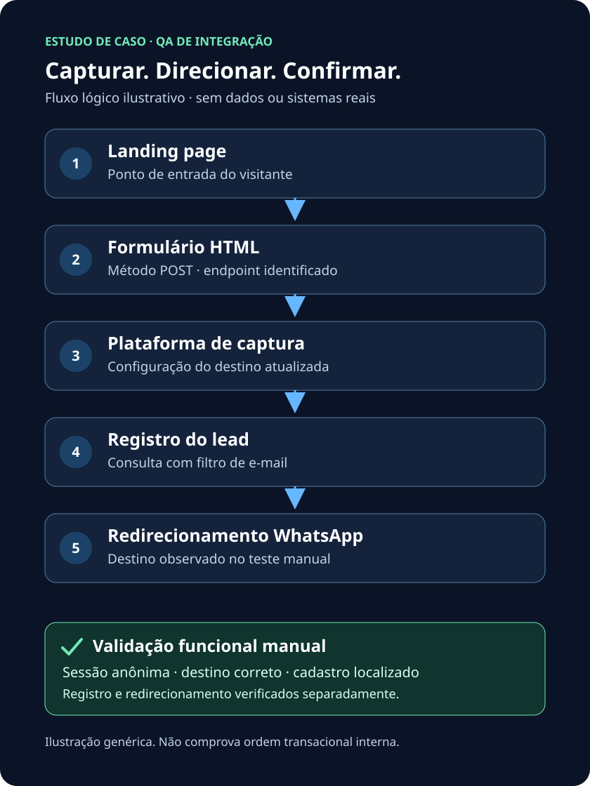

# Investigação e validação de uma integração de captura de leads

Estudo de caso de QA e análise de sistemas, escrito em português brasileiro para um portfólio de estudante de ADS. O trabalho relatado envolveu investigação, manutenção de configuração e validação manual de uma integração existente — não o desenvolvimento de todo o sistema.

> **Confidencialidade:** este material contém somente um relato anonimizado e exemplos didáticos originais. Não inclui código do cliente, capturas administrativas, dados de visitantes ou identificação da plataforma comercial.

## Problema e objetivo

Uma landing page capturava dados de visitantes e os redirecionava para um grupo de WhatsApp. Era necessário atualizar o destino sem prejudicar o cadastro dos leads. O objetivo era descobrir onde essa configuração era mantida e validar as duas etapas do fluxo.

## Tecnologias e conceitos

HTML e formulários com método POST; endpoints; DNS e registros CNAME; integrações web; rastreamento de captura; testes funcionais manuais; navegação anônima; filtros de consulta; troubleshooting e privacidade.

## Metodologia de investigação

1. Inspecionar o HTML e identificar método e endpoint do formulário.
2. Investigar o domínio e os registros CNAME para orientar a identificação da plataforma responsável.
3. Localizar o rastreamento de captura correspondente e sua configuração de destino.
4. Atualizar o redirecionamento na plataforma, mantendo o endpoint e o DNS existentes.
5. Enviar dados de teste em navegação anônima e verificar o destino.
6. Consultar o cadastro pelo filtro de e-mail e confirmar a captura.

Um CNAME orienta a investigação da infraestrutura; isoladamente, não comprova quem processa o formulário nem a existência de um cadastro. Veja a [investigação e suas hipóteses](docs/investigation.md).

## Arquitetura simplificada

Landing page → formulário HTML → plataforma de captura → registro do lead → redirecionamento WhatsApp.

O diagrama representa o fluxo lógico genérico. Não comprova ordem transacional, sincronismo, persistência antes da resposta ou arquitetura interna do fornecedor. Registro e redirecionamento foram verificados separadamente.

## Hipóteses e verificações

| Hipótese inicial | Verificação relatada | Conclusão delimitada |
|---|---|---|
| O destino poderia estar no HTML | Inspeção do método e endpoint; localização da configuração na plataforma | A alteração necessária foi realizada na plataforma |
| Poderia ser necessário alterar DNS | Investigação de CNAME e validação do fluxo existente | Não foi necessário alterar DNS neste atendimento |
| O lead poderia não ter sido salvo | Consulta com filtro de e-mail | O cadastro de teste foi localizado |

## Plano de testes e resultado

Os seis cenários do [plano de testes](docs/test-plan.md) foram **aprovados conforme a validação manual relatada**. O redirecionamento correto foi observado e o lead de teste foi localizado por filtro de e-mail, sem alteração do código da landing page ou do DNS.

A aparente ausência do lead na listagem inicial não comprovava falha de captura. A busca filtrada permitiu confirmar o registro. Não há evidência suficiente para atribuir a ocorrência a atraso, paginação, ordenação ou defeito da plataforma.

Consulte os [resultados e limites das evidências](docs/test-results.md). Nenhum screenshot, log privado ou registro pessoal é publicado. Os resultados históricos não foram reproduzidos pelo exemplo deste repositório.

## Aprendizados

- Separar captura e redirecionamento em verificações independentes.
- Investigar a configuração responsável antes de alterar HTML ou DNS.
- Usar filtros específicos para verificar um cadastro aparentemente ausente.
- Distinguir hipótese, observação e confirmação.
- Documentar um caso real preservando confidencialidade.

Detalhes em [aprendizados e próximos passos](docs/lessons-learned.md).

## Exemplo educativo

Abra [examples/generic-form.html](examples/generic-form.html) em um navegador. O exemplo usa um domínio reservado, campos desabilitados e botão desabilitado. Não envia dados, não captura leads e não redireciona para grupos. Foi criado somente para este portfólio e não representa código do cliente.

## Limitações e próximos passos

Não foram relatados testes automatizados da integração, inspeção de requisições via DevTools, testes de carga, testes de segurança ou desenvolvimento do sistema. Não há métricas de conversão ou garantia de comportamento para todos os usuários.

Antes de publicar, revisar este material e aprovar explicitamente a criação do repositório público. Uma futura demonstração funcional deve usar ambiente próprio e dados sintéticos, com autorização para os testes.

## Documentos

- [Investigação](docs/investigation.md)
- [Plano de testes](docs/test-plan.md)
- [Resultados](docs/test-results.md)
- [Aprendizados](docs/lessons-learned.md)
- [Auditoria dos artefatos públicos](docs/privacy-review.md)

Não há recursos externos necessários para visualizar a documentação ou o SVG.
